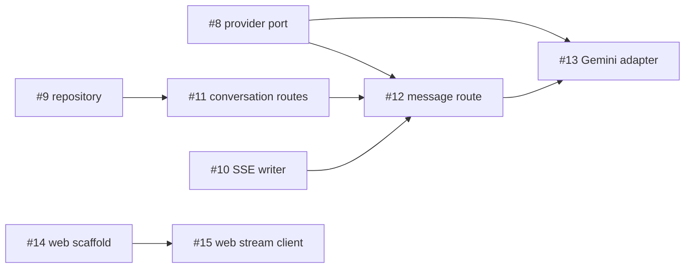

# Chat API (Phase 2)

The spec that issues #8–#15 build against. Interfaces here are binding: if one can't work
as written, stop and ask in the issue instead of changing it. Wire formats come from
[packages/shared](../../packages/shared/src/index.ts) and the
[stream protocol](../architecture/stream-protocol.md); nothing here changes them.

## Goals

* Create a conversation, send a message, and stream the reply into the browser.
* Run end to end with no API key (echo provider) and with Gemini when a key is set.
* Every server behaviour testable without the network.

Not in Phase 2: authentication, persistence across restarts, editing or deleting
messages, tools, and the chat UI (that comes after the Phase 3 UI sensors).

## Routes

| Method and path | Success | Errors (JSON `ApiErrorBody`) |
| --- | --- | --- |
| `POST /api/conversations` | `201` `ConversationResponse`, no messages | — |
| `GET /api/conversations/:id` | `200` `ConversationResponse` | `404 not_found` (unknown or not a UUID) |
| `POST /api/conversations/:id/messages` | `200` `text/event-stream` of `ChatStreamEvent` | `400 validation_failed`, `404 not_found`, `409 conflict` |

JSON bodies are limited to 64 kB. Malformed or oversized bodies return
`400 validation_failed`, never `500`.

## Streaming a reply

`POST /api/conversations/:id/messages` with a `SendMessageRequest`:

1. Validate the body with `SendMessageRequestSchema`. Failure: `400 validation_failed`,
   with `details` listing each issue's path and message.
2. Load the conversation. Missing: `404 not_found`.
3. If a message with id `clientMessageId` already exists, or an assistant message is
   `streaming`: `409 conflict`. The client's id becomes the user message id, which makes
   retries safe.
4. Append the user message (`status: complete`) and an assistant message
   (new UUID, `status: streaming`, no parts).
5. Open the event stream and send `message.started`, with `model` taken from the provider.
6. Call `provider.streamReply({ history, signal })`. The history holds every `complete`
   message in order, including the new user message, with its `providerSteps`.
   * `text`: send `text.delta` and append to the reply text in memory.
   * `completed`: store the reply (one text part, `status: complete`, `metadata` with
     model, finishReason, usage, ttftMs, durationMs, plus `providerSteps`), then send
     `message.completed` and close.
   * `failed`: store `status: error` and `error`, then send an `error` event and close.
7. If the provider throws, handle it as `failed` with `code: internal` and the message
   `"Internal error"`. The thrown message never reaches the client.
8. If the client disconnects first (`res.on('close')`), abort the `signal`, store the
   partial text with `status: aborted`, and send nothing more.

Errors before step 5 are HTTP errors. After step 5 the status is already `200`, so they
can only be `error` events.

| Provider failure code | Stream `error.code` | `retryable` |
| --- | --- | --- |
| `provider_rate_limited` | `provider_rate_limited` | `true` |
| `provider_unavailable` | `provider_unavailable` | `true` |
| `content_blocked` | `content_blocked` | `false` |
| `internal`, or a thrown error | `internal` | `false` |

## Server modules

```text
apps/server/src/
  app.ts                      createApp(deps): middleware, routes, error handling
  main.ts                     reads env, picks the provider, listens
  env.ts                      Zod-parsed environment
  http/event-stream.ts        SSE writer (#10)
  conversations/repository.ts interface + toConversation (#9)
  conversations/memory-repository.ts                     (#9)
  llm/provider.ts             the port (#8)
  llm/fake-provider.ts        scripted fake + echo provider (#8)
  llm/gemini/                 the only place that imports @google/genai (#13)
```

### LLM provider port

```ts
export type LlmTurn = {
  readonly role: 'user' | 'assistant';
  readonly text: string;
  readonly providerSteps?: unknown; // opaque; only the provider that produced it reads it
};

export type LlmFailureCode = 'provider_rate_limited' | 'provider_unavailable' | 'content_blocked' | 'internal';

export type LlmEvent =
  | { readonly type: 'text'; readonly delta: string }
  | {
      readonly type: 'completed';
      readonly finishReason: FinishReason;
      readonly usage?: TokenUsage;
      readonly providerSteps?: unknown;
    }
  | { readonly type: 'failed'; readonly code: LlmFailureCode; readonly message: string };

export interface LlmProvider {
  readonly model: string;
  streamReply(input: { readonly history: readonly LlmTurn[]; readonly signal: AbortSignal }): AsyncIterable<LlmEvent>;
}
```

A provider ends with exactly one `completed` or `failed` event, or stops early when
`signal` aborts. `FinishReason` and `TokenUsage` come from `@genui/shared`.

### Conversation repository

```ts
export type StoredMessage = { readonly message: Message; readonly providerSteps?: unknown };

export type StoredConversation = {
  readonly id: string;
  readonly createdAt: string;
  readonly updatedAt: string;
  readonly messages: readonly StoredMessage[];
};

export type MessagePatch = Partial<Pick<Message, 'parts' | 'status' | 'metadata' | 'error'>> & {
  readonly providerSteps?: unknown;
};

export class RepositoryError extends Error {
  readonly code: 'not_found' | 'conflict';
}

export interface ConversationRepository {
  create(): Promise<StoredConversation>;
  get(id: string): Promise<StoredConversation | undefined>;
  appendMessage(conversationId: string, message: StoredMessage): Promise<void>;
  updateMessage(conversationId: string, messageId: string, patch: MessagePatch): Promise<void>;
}
```

The methods are asynchronous, so a database can replace the in-memory version later
without touching routes. `RepositoryError` sets `code` in its constructor (no parameter
properties: Node strips types only).

### SSE writer

```ts
export interface EventStream {
  send(event: ChatStreamEvent): boolean; // false once closed
  close(): void;
  readonly closed: boolean;
}

export function openEventStream(res: Response, options?: { heartbeatMs?: number }): EventStream;
```

### App wiring

```ts
export type AppDeps = {
  readonly repository: ConversationRepository;
  readonly provider: LlmProvider; // added by #12
};

export function createApp(deps: AppDeps, registerRoutes?: (app: Express) => void): Express;
```

`main.ts` uses the memory repository, and Gemini when `GEMINI_API_KEY` is set; otherwise
the echo provider, with a one-line warning at startup.

## Work plan



Wave 1: #8, #9, #10, #14 (and #7). Wave 2: #11, #15. Wave 3: #12. Wave 4: #13.
